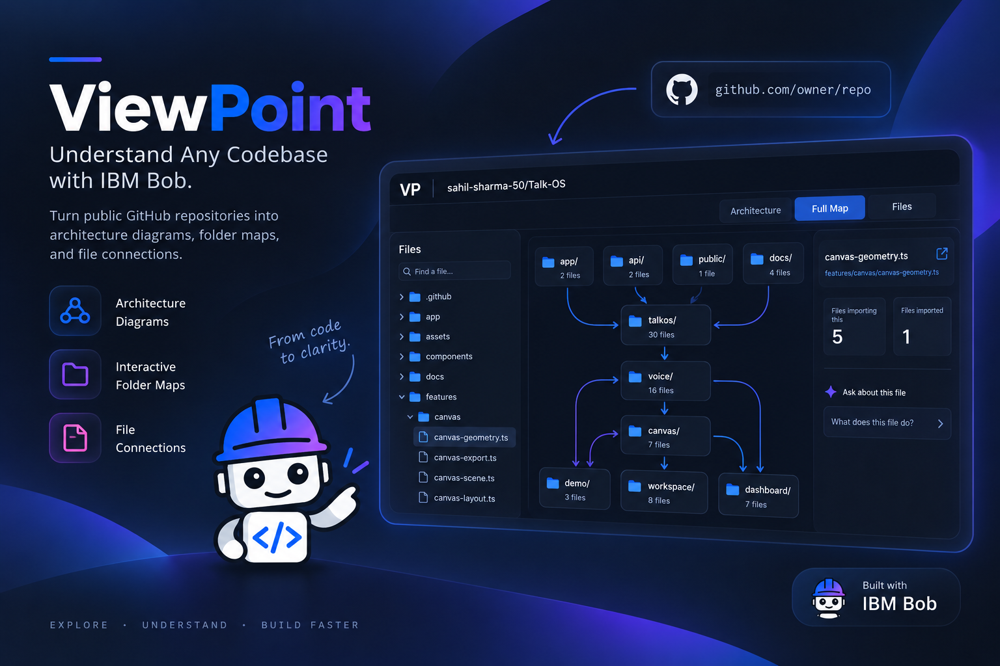
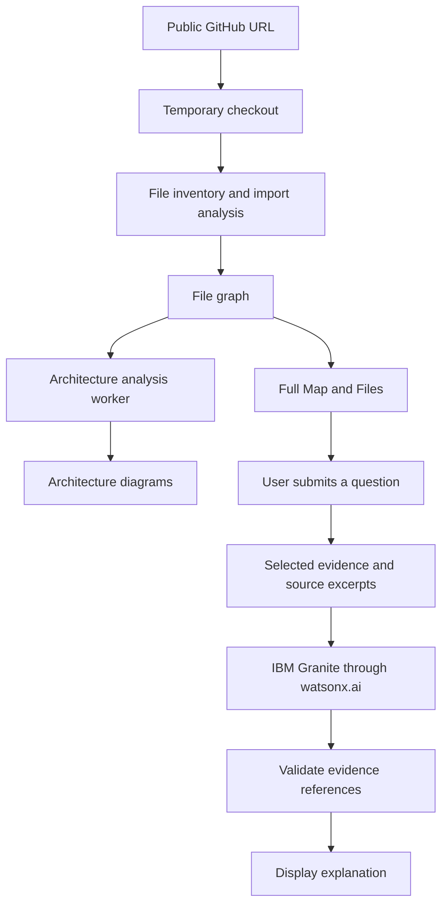

# ViewPoint

**From code to clarity.**

ViewPoint helps developers understand an unfamiliar public GitHub repository. Paste a repository URL, explore its architecture, follow connections between folders and files, and ask IBM Granite questions about selected source evidence.

Built with **IBM Bob** for the **IBM Bob 2.0 Hackathon**.



**Live app for judges: [viewpoint-bob.vercel.app](https://viewpoint-bob.vercel.app/)** — paste any supported public GitHub repository URL to explore it. No account is required.

[Quick start](#quick-start) · [Explore the app](#explore-the-app) · [How IBM Bob helped](#how-ibm-bob-helped-build-viewpoint) · [Optional AI setup](#optional-ai-setup) · [Verification](#verification)

## What we built

Getting started in a codebase means answering practical questions: Where does the application start? Which modules depend on one another? Where does a request go? What does this file do?

ViewPoint brings those questions into three connected views:

| View | What you can explore |
| --- | --- |
| **Architecture** | System components, source-level flows, module dependencies, declared infrastructure, and observed state updates. Select a component or arrow to inspect its supporting files. |
| **Full Map** | An interactive folder map with expandable groups, file search, and known import and HTTP connections. Inspect a selection and ask questions about it. |
| **Files** | Individual files, their importers and dependencies, source links on GitHub, and optional AI explanations. |

Architecture includes five diagrams: **System**, **Flow**, **Dependencies**, **Deployment / Infrastructure**, and **State / Lifecycle**. Each uses the facts detected in the repository; a view may be empty when no supporting facts are found.

## How IBM Bob helped build ViewPoint

IBM Bob was used in the `IBM_Bob_2.0` workspace to plan the project, scaffold its early code, build repository intake and dependency analysis, and shape the interface. The saved Bob task screenshots show the sequence:

| Stage | What the Bob task records show |
| --- | --- |
| [Plan](bob_sessions/solorun_task00_create_last_rites_plan.png) | A request to read the hackathon brief, break the original concept into implementation tasks, and define acceptance checks. |
| [Scaffold](bob_sessions/solorun_task01_scaffold_types_demo.png) | A request to create shared types and an initial demo fixture before implementing the repository flow. |
| [Repository intake](bob_sessions/solorun_task02_github_repo_cloner.png) and [analysis](bob_sessions/solorun_task03_typescript_dependency_graph.png) | Tasks for a public GitHub cloner and a deterministic TypeScript import graph. |
| [Dependency UI](bob_sessions/solorun_task04_dependency_view.png) and [web integration](bob_sessions/solorun_task06_web_cli_integration.png) | Tasks for an interactive dependency view, a repository URL input, and server-side analysis sessions. |
| [Product and UI direction](bob_sessions/solorun_task07_viewpoint_product_direction.png) and [rename](bob_sessions/solorun_task08_project_name_change.png) | The later brief redirected the UI toward the current landing page, example repositories, Architecture / Full Map / Files views, and file questions, then renamed the project ViewPoint. |

The first plan was for an earlier concept. ViewPoint kept the repository mapping foundation and changed direction; features from that earlier concept are not part of the current product. These images capture Bob task requests, while the current source and [automated checks](#verification) show what is implemented. The [complete screenshot index](bob_sessions/README.md) includes the remaining sessions.

## Quick start

### 1. Install the prerequisites

- **Node.js 20.9 or newer**, with npm.
- **Git**, available on your `PATH`.
- An internet connection to download dependencies and clone public GitHub repositories.
- **Python 3** for Python, Go, and Java connection scanning. JavaScript and TypeScript scanning runs in Node.js.

### 2. Clone and install

```bash
git clone https://github.com/sahil-sharma-50/ViewPoint.git
cd ViewPoint
npm ci
```

### 3. Start the app

```bash
npm run dev
```

Open **[http://localhost:3000](http://localhost:3000)** and enter a public GitHub URL or `owner/repository`, for example:

```text
https://github.com/sahil-sharma-50/ViewPoint
```

The maps work without IBM credentials. To enable questions and answers, follow [Optional AI setup](#optional-ai-setup).

### Enable Python, Go, and Java scanning

Python imports are scanned with Python's built-in `ast` module. Go and Java additionally need tree-sitter and their language grammars.

**Windows / PowerShell:**

```powershell
python -m pip install --target .tools/python tree-sitter==0.26.0 tree-sitter-go==0.25.0 tree-sitter-java==0.23.5
```

**macOS / Linux:**

```bash
python3 -m pip install --target .tools/python tree-sitter==0.26.0 tree-sitter-go==0.25.0 tree-sitter-java==0.23.5
```

Run these commands from the project root. ViewPoint automatically includes `.tools/python` when starting its language helpers. It invokes `python` on Windows and `python3` on macOS/Linux, so that command must be available on your `PATH`.

If a language scan fails, the app displays a coverage warning. Files can still appear in the inventory even when their connections could not be scanned.

## Explore the app

1. **Analyse a repository.** Paste its public GitHub URL and select **Analyse Repository**. ViewPoint clones a temporary copy and builds the source map.
2. **Start with Architecture.** Choose a diagram and select components or arrows to see their source evidence.
3. **Open Full Map.** Expand folders, find a file, and inspect the connections around your selection.
4. **Inspect Files.** See which files import the selected file and which files it imports. Open the source on GitHub for more context.
5. **Ask a focused question.** With Granite configured, use the question box in Full Map or Files. Try “What does this file do?” or “How are these files connected?”

### Read the arrows

| Connection | Meaning |
| --- | --- |
| **Import** | Points from the importing file or component toward the dependency it imports. Test imports are included. |
| **HTTP call** | Shows a request found in source. A local destination is matched only when its method and route resolve unambiguously. |
| **Deployment** | Represents declarations found in configuration, such as container images, infrastructure resources, or runtime commands. |
| **State update** | Connects a state variable to an observed literal setter value. It does not establish a sequence of state transitions. |

## Optional AI setup

**IBM Bob** supported development of the application. **IBM Granite through watsonx.ai** provides the optional explanations inside it.

The maps are generated by local source analysis. An AI request is made when you submit a question; it includes the question, selected graph evidence, and bounded source excerpts. The server checks the returned evidence references before presenting the answer. Generated explanations still need to be read against the source.

### Configure watsonx.ai

Copy [`.env.example`](.env.example) to `.env` in the project root:

```powershell
# Windows / PowerShell
Copy-Item .env.example .env
```

```bash
# macOS / Linux
cp .env.example .env
```

Fill in the values for your IBM project, then restart the app:

```dotenv
WATSONX_API_ENDPOINT=https://eu-de.ml.cloud.ibm.com
WATSONX_PROJECT_ID=your-project-id
WATSONX_API_KEY=your-api-key
WATSONX_MODEL_ID=ibm/granite-4-h-small
```

| Variable | Purpose |
| --- | --- |
| `WATSONX_API_ENDPOINT` | Regional API endpoint for your watsonx.ai service. The example uses Frankfurt; use the endpoint for your project. |
| `WATSONX_PROJECT_ID` | Project used for model inference. |
| `WATSONX_API_KEY` | IBM Cloud API key with access to that project and service. |
| `WATSONX_MODEL_ID` | Optional model override; defaults to `ibm/granite-4-h-small`. The model must be available to your project. |

Credentials stay on the server. `.env` is ignored by Git; never commit credentials or prefix them with `NEXT_PUBLIC_`. Model requests use your IBM service and may incur usage charges. If AI is unavailable, the source maps remain usable.

## How it works



The file graph becomes available independently of Architecture preparation. Next.js and the Express API run in one Node.js process; analysis workers handle repository scanning.

On Vercel, Next.js route handlers download a public GitHub archive, build both maps in one request, and store a compressed 24-hour session in a private Vercel Blob store. Later requests load that saved map. IBM credentials stay in server-side Vercel environment variables.

### Technology

| Layer | Implementation |
| --- | --- |
| Interface | Next.js App Router, React, TypeScript |
| API and sessions | Local: Express and temporary checkouts; Vercel: Next.js route handlers and private Blob sessions |
| JavaScript / TypeScript analysis | TypeScript compiler API |
| Python analysis | Python `ast` |
| Go / Java analysis | tree-sitter with language grammars |
| Graph layout | Dagre and custom SVG rendering |
| AI explanations | IBM Granite via watsonx.ai |
| Verification | Vitest, ESLint, TypeScript compilation, Next.js production build |

### Project structure

```text
app/
  architecture/       System diagrams and source inspection
  full-map/           Interactive folder and connection map
  graph-view/         File explorer and file inspector
src/
  web-server.ts       Combined Next.js and Express entry point
  server.ts           Analysis and explanation API routes
  vercel-repo.ts      Bounded public GitHub archive analysis on Vercel
  vercel-session.ts   Private Blob session storage and expiry
  clone-repo.ts       Public repository cloning and checkout limits
  analyse-repo.ts     File inventory and import graph construction
  architecture.ts    Component, route, HTTP, deployment, and state facts
  analysis-worker.ts  Background analysis orchestration
  session-store.ts    Session persistence and expiry
  watsonx.ts          Server-side IBM model integration
  helpers/            Python, Go, and Java scanning helpers
  __tests__/          Automated checks
assets/               Project cover image
bob_sessions/         IBM Bob session screenshots
```

## Production and configuration

**Public deployment:** [https://viewpoint-bob.vercel.app/](https://viewpoint-bob.vercel.app/). `view-point.vercel.app` was unavailable, so the project uses the requested alternate name.

### Deploy your own Vercel instance

1. Run `npm ci` and `npx vercel link` from the project root. Create or select a Vercel project; `vercel.json` selects the Next.js framework.
2. Create a **private Vercel Blob store** in the Vercel dashboard and connect it to the project. Vercel supplies `BLOB_READ_WRITE_TOKEN` to the deployment.
3. For optional Granite answers, add `WATSONX_API_ENDPOINT`, `WATSONX_PROJECT_ID`, and `WATSONX_API_KEY` as **Sensitive** Production environment variables in Vercel Project Settings. Set `WATSONX_MODEL_ID` only if your project needs a different model. Never use `NEXT_PUBLIC_` for these values.
4. Add a random `CRON_SECRET` as a Sensitive Production environment variable. The daily `/api/cleanup` cron uses it to delete sessions older than 24 hours.
5. Run `npx vercel deploy --prod`. Configure Deployment Protection so the production domain is public if visitors should use it without a Vercel account.

The Vercel archive path accepts public GitHub repositories up to a 35 MB compressed download, 90 MB extracted content, 5,000 files, and a 4 MB compressed session. It does not rely on a persistent Git checkout. Python, Go, and Java connection scanning needs a Python runtime and optional grammars, so those languages may show coverage warnings on Vercel; JavaScript and TypeScript maps work in Node.js. Local limits below apply to the Express process.

### Run the local production server

Build and run locally in production mode:

```bash
npm run build
npm start
```

Keep the source helper scripts and any installed Python grammars available alongside the application when running it.

Set these environment variables **in your shell before starting the server** to change runtime limits:

| Variable | Default | Purpose |
| --- | --- | --- |
| `PORT` | `3000` | HTTP listening port. |
| `VIEWPOINT_MAX_REPO_MB` | `512` | Maximum checkout size in MB, including Git objects. |
| `VIEWPOINT_MAX_FILES` | `30000` | Maximum file inventory size. |

For example, use a different port:

```powershell
# Windows / PowerShell
$env:PORT = '3001'
npm run dev
```

```bash
# macOS / Linux
PORT=3001 npm run dev
```

Sessions expire after **24 hours**. Completed analyses have best-effort snapshots in the operating system's temporary directory and can survive a restart on the same disk. Expiry removes the session and its temporary clone.

## Verification

| Command | Checks |
| --- | --- |
| `npm test` | Automated tests for analysis, graph relationships, diagrams, API behavior, sessions, and AI evidence validation. |
| `npm run lint` | ESLint checks for application and server code. |
| `npm run build` | Server compilation and the Next.js production build. |

The live GitHub clone test is opt-in because it requires network access:

```powershell
# Windows / PowerShell
$env:VIEWPOINT_INTEGRATION = '1'
npx vitest run src/__tests__/clone-repo.integration.test.ts
Remove-Item Env:VIEWPOINT_INTEGRATION
```

```bash
# macOS / Linux
VIEWPOINT_INTEGRATION=1 npx vitest run src/__tests__/clone-repo.integration.test.ts
```

[IBM Bob task screenshots](bob_sessions/README.md) document the project's development history, including its shift to ViewPoint.

## Scope and limitations

- **Public GitHub repositories only.** GitHub access tokens and private repositories are not supported.
- **Read-only analysis.** ViewPoint reads a temporary checkout. It does not execute the analyzed application's code or modify its source.
- **Static evidence.** Computed imports, dynamic request destinations, external behavior, and runtime-only relationships may be missing. A missing arrow is not proof that no relationship exists.
- **Language coverage varies.** Connection scanning supports JavaScript, TypeScript, Python, Go, and Java. Rich architecture facts depend on recognized source and configuration patterns; support is not identical across languages or frameworks.
- **Inventory and display differ.** Git checkouts inventory tracked regular files, including configuration and generated files. Full Map hides dot paths. Symlinks are excluded; local directories without Git metadata also exclude dependency, build, and cache directories.
- **Coverage is disclosed.** Failed scans and diagram display limits appear in the interface. Go package imports do not capture implicit same-package file references or evaluate build constraints.

## Troubleshooting

| Symptom | What to check |
| --- | --- |
| Repository cannot be cloned | Confirm the URL is public, Git is on `PATH`, and the server can reach GitHub. Check the reported disk, network, or checkout-limit error. |
| Python, Go, or Java scan warning | Check the platform's Python command and install the grammars using the instructions above. |
| Granite is not configured | Fill in `.env` and restart the application. All three source views work without it. |
| IBM authentication or model error | Check the API key, project access, regional endpoint, and model availability for your project. |
| Session expired | Return to the start page and analyse the repository again. |
| Port already in use | Stop the process using that port or set `PORT` to another value. |

## License

[MIT](LICENSE) — Copyright © 2026 Sahil Sharma.
