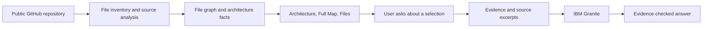

# ViewPoint

ViewPoint turns a public GitHub repository into an explorable map of its architecture, folders, files, and source connections. Paste a URL to see how the code fits together, inspect the evidence behind each diagram, and ask IBM Granite focused questions about selected files. IBM Bob helped plan, build, and refine the project; the repository analysis itself is deterministic and works without AI credentials.


**Try it: [viewpoint-bob.vercel.app](https://viewpoint-bob.vercel.app/)**. No account is required.

## Explore ViewPoint

| View | What it shows |
| --- | --- |
| **Architecture** | Source-backed system, flow, dependency, deployment, and state diagrams. Select a component or arrow to see its supporting files. |
| **Full Map** | Expandable folders, search, and known import and HTTP connections. |
| **Files** | Each file's imports, importers, and link to its source on GitHub. |

Import arrows point from the importing file to the file it imports, including imports from tests. HTTP arrows represent requests found in source and connect to a local route only when the method and path resolve clearly. A missing arrow does not prove that no connection exists: dynamic behavior may not be visible to static analysis.

IBM Granite answers are optional. ViewPoint sends a question only when you ask one, along with selected graph evidence and limited source excerpts. It checks the model's evidence references before displaying an answer.

## Run locally

Install **Node.js 20.9+** and **Git**, then run:

```bash
git clone https://github.com/sahil-sharma-50/ViewPoint.git
cd ViewPoint
npm ci
npm run dev
```

Open [localhost:3000](http://localhost:3000) and enter a public GitHub URL or `owner/repository`. The maps work without IBM credentials.

For Python import scanning, install Python 3. Go and Java scanning also need tree-sitter grammars. Run the command for your platform from the project root:

```powershell
# Windows
python -m pip install --target .tools/python tree-sitter==0.26.0 tree-sitter-go==0.25.0 tree-sitter-java==0.23.5
```

```bash
# macOS or Linux
python3 -m pip install --target .tools/python tree-sitter==0.26.0 tree-sitter-go==0.25.0 tree-sitter-java==0.23.5
```

ViewPoint shows a coverage warning if a language scanner is unavailable.

### Enable IBM Granite explanations

Copy `.env.example` to `.env`, enter your own watsonx.ai values, and restart the app:

```dotenv
WATSONX_API_ENDPOINT=https://eu-de.ml.cloud.ibm.com
WATSONX_PROJECT_ID=your-project-id
WATSONX_API_KEY=your-api-key
WATSONX_MODEL_ID=ibm/granite-4-h-small
```

`WATSONX_MODEL_ID` is optional. Keep credentials on the server; `.env` is Git ignored, and IBM values must never use a `NEXT_PUBLIC_` prefix. Model requests may incur IBM usage charges.

## How it works



Local development runs Next.js and Express in one process. It clones a temporary repository checkout, builds the file graph, and prepares Architecture independently. On Vercel, Next.js route handlers analyze a bounded public GitHub archive and save the result as a private, compressed Vercel Blob session for 24 hours. Both paths use the TypeScript compiler API for JavaScript and TypeScript. Python uses `ast`; Go and Java use tree-sitter through the Python helper.

## Deploy on Vercel

The public instance is [viewpoint-bob.vercel.app](https://viewpoint-bob.vercel.app/). To deploy your own:

1. Run `npm ci` and `npx vercel link`. The included `vercel.json` selects Next.js.
2. Create a **private Vercel Blob store** and connect it to the project. Vercel supplies `BLOB_READ_WRITE_TOKEN`.
3. Add `CRON_SECRET` as a random, Sensitive Production environment variable. The daily cleanup removes expired sessions.
4. To enable Granite, add `WATSONX_API_ENDPOINT`, `WATSONX_PROJECT_ID`, and `WATSONX_API_KEY` as Sensitive Production variables. Add `WATSONX_MODEL_ID` only if needed.
5. Run `npx vercel deploy --prod` and make the production domain public in Deployment Protection settings.

The Vercel path accepts public repositories up to a 35 MB archive download, 90 MB extracted content, 5,000 files, and a 4 MB compressed session. Python, Go, and Java connection scans may show coverage warnings if their runtime or grammars are unavailable there.

For a local production build, run `npm run build` and `npm start`. The local Express server defaults to port `3000`; optional limits are `VIEWPOINT_MAX_REPO_MB=512` and `VIEWPOINT_MAX_FILES=30000`.

## Built with IBM Bob

IBM Bob supported planning, early scaffolding, repository intake, dependency analysis, and UI direction. The saved task screenshots show that progression:

| Stage | Bob session evidence |
| --- | --- |
| Plan and scaffold | [Plan](bob_sessions/solorun_task00_create_last_rites_plan.png), [scaffold](bob_sessions/solorun_task01_scaffold_types_demo.png) |
| Repository mapping | [GitHub intake](bob_sessions/solorun_task02_github_repo_cloner.png), [dependency graph](bob_sessions/solorun_task03_typescript_dependency_graph.png) |
| Interface and integration | [Dependency UI](bob_sessions/solorun_task04_dependency_view.png), [web integration](bob_sessions/solorun_task06_web_cli_integration.png) |
| Current product direction | [ViewPoint direction](bob_sessions/solorun_task07_viewpoint_product_direction.png), [name change](bob_sessions/solorun_task08_project_name_change.png) |

The initial plan explored an earlier concept. The [session index](bob_sessions/README.md) records the remaining tasks, while the current source and tests show what ViewPoint implements today.

## Verify

| Command | Purpose |
| --- | --- |
| `npm test` | Analysis, diagrams, API behavior, sessions, and AI evidence checks |
| `npm run lint` | ESLint |
| `npm run build` | TypeScript compilation and Next.js production build |

ViewPoint supports public GitHub repositories only. It reads source without executing or editing the analyzed project. Static analysis can miss computed imports, dynamic requests, and runtime-only behavior. Sessions expire after 24 hours; start a new analysis when a session expires.

## License

[MIT](LICENSE). Copyright © 2026 Sahil Sharma.
